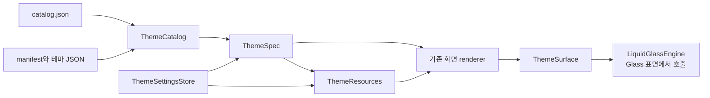

# 테마 엔진 구조와 적용 흐름

테마 엔진은 정적 테마 번들을 검증해 기존 Dashboard renderer가 사용할 값과 자산으로 바꾼다. 이 문서는 코드의 역할과 변경 흐름을 안내한다. JSON 키와 병합 규칙은 [테마 엔진 v3 규격](../../../../docs/theme_engine_v3.md)을 정본으로 삼는다.

## 한눈에 보는 흐름

`catalog.json`은 포함할 테마 ID를 정한다. 각 manifest는 파일과 선택적인 부모 테마를 선언한다. `ThemeCatalog`가 정의를 검증하고 상속 규칙을 적용해 `ThemeSpec`을 구성한다. `ThemeResources`는 bitmap과 글꼴을 준비하고, 기존 renderer와 `ThemeSurface`가 이를 화면에 그린다. Glass 재질이 지정된 표면만 `LiquidGlassEngine`을 사용한다.

잘못된 정의가 부분적으로 적용되지 않도록 로더는 현재 v3 계약의 Original fallback을 사용한다. 어떤 필드가 필수인지, 상속 파일이 어떻게 병합되는지, 오류 범위가 어디까지인지는 v3 규격을 따른다.

## 코드가 맡는 일

| 구성 요소 | 책임 |
|---|---|
| `ThemeCatalog` | catalog·manifest·JSON 읽기, 스키마 키와 값 검증, 테마 해석 |
| `ThemeSpec` | renderer가 참조할 색 역할, surface, layout, 글꼴, 배경 정보를 제공 |
| `ThemeRepository` | 저장된 ID를 catalog에서 복원하고 지원하지 않는 버전을 Original로 처리 |
| `ThemeResources` | 적용 전에 테마의 이미지와 글꼴 준비 |
| `ThemeSettingsStore` | 적용된 테마와 사용자 palette·wallpaper·표시 설정 저장 |
| `ThemeSurface` | 기존 Canvas renderer가 공통으로 사용하는 표면 그리기 |
| `LiquidGlassEngine` | Glass 표면의 흐림, 그라데이션, 투명도와 하이라이트 합성 |

`ThemeResources` 로딩과 JSON 파싱은 프레임마다 실행하지 않는다. 테마는 표시 스타일만 정하며 차량 데이터의 계산이나 유효성, 명령 동작을 소유하지 않는다.

## 테마를 확장하는 순서

테마 JSON만으로 표현 가능한 변경은 번들에서 해결한다. 새 런타임 동작이 필요할 때는 순서대로 확장한다.

1. v3 schema에 속성과 값 범위를 정의한다.
2. `ThemeCatalog` parser와 validator에서 값을 읽고 잘못된 값을 거부한다.
3. `ThemeSpec` accessor, 복사, 상속과 동등성 처리에 새 값을 연결한다.
4. renderer와 같은 geometry를 쓰는 hit-test에 값을 적용한다.
5. 누락·오류 시 안전한 동작과 Original·기존 테마 회귀를 테스트한다.
6. 설정값이라면 저장, 취소, 재적용과 기본값 복귀를 연결한다.

Overview는 모든 테마에서 5×4 단일 화면이다. 신규 독립 테마는 Original을 부모로 지정하지 않는다. 기존 파생 테마의 명시적 부모 관계는 계획된 변경 없이 제거하지 않는다.

## 설정과 미리보기

테마 선택은 임시 선택과 저장된 선택을 구분한다. 사용자가 적용할 때만 테마 ID를 저장하고, 취소하면 이전 선택을 유지한다. 미리보기는 고정 합성 telemetry와 기존 renderer를 사용하며 차량 명령을 보내지 않는다.

Palette는 테마 ID별로 보관하고, 직접 선택 wallpaper는 전역 선택으로 보관한다. 배경 설정이 비어 있으면 활성 테마의 기본 배경을 쓴다. Liquid Glass palette에 맞춰 기본 배경을 자동 변경하는 기능은 아직 구현 범위에 포함되지 않았으며, 상세 요구는 [테마 규격](THEME_SPEC_GUIDE.md#liquid-glass-배경-선택)에 있다.

## 검증 위치

테마 파일은 `apps/dashboard/src/0x1101L/assets/themes/`, 엔진 구현은 `apps/dashboard/src/0x1101L/java/com/veloster/dashboard/theme/`에 있다. 앱 적용과 설정 진입은 `apps/dashboard/src/main/java/com/veloster/dashboard/view/DashboardView.java`를 확인한다.

검증은 manifest/schema와 catalog 로딩에서 시작해 설정 저장·취소, renderer와 hit-test, Original 및 기존 테마 회귀 순으로 진행한다. Java host 프리뷰는 Android API 17 기기 또는 실차 검증과 동일하지 않다.

## 다음 문서

- [화면 및 디자인 규격](THEME_SPEC_GUIDE.md)
- [CoWork 공용 테마 계약](COWORK_ENGINE_GUIDE.md)
- [테마 엔진 v3 JSON 규격](../../../../docs/theme_engine_v3.md)
- [Material Auto 조사·구현 규격](../../../../docs/MATERIAL_AUTO_THEME_RESEARCH_SPEC_20261119.md)
