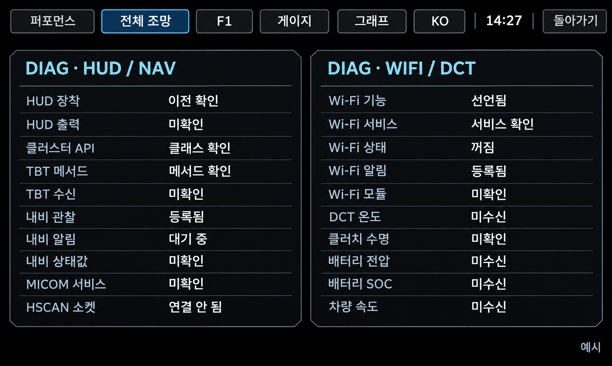

# JS (`js_kr`) 독립 진단 도구

## CarPlay ADB 관찰 항목

`carplay_adb_probe.py`는 등록된 읽기 전용 항목만 실행합니다. 연결된 ADB 기기가 온라인인지 확인한 뒤 제품·API·정확한 incremental을 확인하고, 대상이 `js_kr` / API 17 / `eng.vmadmin.20260114.090656`와 일치할 때만 inventory 또는 선택한 진단 이벤트 로그 회수를 진행합니다.

한 번에 대상 확인 후 패키지와 서비스 inventory를 순서대로 실행하려면 [2026-11-15 단계별 시험 계획](../../docs/CARPLAY_TBT_TEST_PLAN_20261115.md)과 runner를 사용합니다. 이 준비 단계에는 연결·TBT payload·raw iAP2·HUD 시험이 포함되지 않습니다.

```sh
python3 diag/js_kr/carplay_adb_probe.py --serial DEVICE_SERIAL
python3 diag/js_kr/carplay_adb_probe.py --serial DEVICE_SERIAL --check packages
python3 diag/js_kr/carplay_adb_probe.py --serial DEVICE_SERIAL --check services
python3 diag/js_kr/carplay_adb_probe.py --serial DEVICE_SERIAL --check events-current --check events-previous
sh diag/js_kr/run_carplay_tbt_preflight.sh DEVICE_SERIAL inventory
sh diag/js_kr/run_carplay_tbt_preflight.sh DEVICE_SERIAL events
```

등록 항목은 `packages`(정해진 CarPlay/DiPO/iAP2 패키지 이름의 존재 여부), `services`(정해진 cluster 서비스 이름의 존재 여부), `events-current`/`events-previous`(Dashboard의 bounded private `HUD_EVENT` 파일에서 허용된 시각·이벤트·요약값만 읽기)입니다. `--list`로 항목을 확인할 수 있습니다. 이벤트 회수는 사용자가 사전에 실행한 Dashboard APK의 로그만 읽으며 TBT 입력을 만들지 않습니다. 원시 CarPlay log는 읽지 않고 제목·가수·목적지 등 개인 메타데이터를 출력하지 않습니다. 결과는 stdout JSON이며 serial과 전체 패키지·서비스 목록은 출력하지 않습니다. 대상 불일치·권한 오류·ADB 실패는 성공 관찰과 구분합니다.

기본 inventory는 `adb get-state`, 대상 확인용 `getprop`, `pm list packages`, `service list`를 사용합니다. 명시적 이벤트 회수 선택 시에만 `run-as com.veloster.dashboard cat files/diagnostics/hud-events*.log`를 각각 읽습니다. 설정 변경, 설치·실행, logcat, 소켓 접근, 네트워크 ADB/포워딩, 원시 iAP2 로그·CarPlay 안내 데이터 수집은 하지 않습니다. package/service inventory는 TBT를 입증하지 않으며, event 파일의 미기록·회수 실패도 TBT 부재를 입증하지 않습니다. 현재는 호스트 모의 검증만 하며 실기기 검증은 미실시입니다. 실행 시 정차 상태와 승인된 USB ADB 연결을 전제로 하고, 결과의 기기·환경 식별값은 공유 전에 검토하세요.

대상은 `js_kr` / `eng.vmadmin.20260114.090656`이다. Dashboard APK와 별개이며 이 도구 작성만으로 빌드·설치·실차 동작이 검증된 것은 아니다. ADB serial을 명시하고 정차 상태에서 사용한다. 원시 HSCAN은 차량 정보를 포함할 수 있으므로 저장소 밖 비공개 경로에 보관한다.

## 진단 화면 예시

아래 이미지는 저장소의 미리보기 자료이며, 차량에서 촬영한 실화면이나 실차 검증 증거가 아닙니다.



## 장치와 Wi-Fi

```sh
python3 diag/js_kr/hardware_inventory.py --serial DEVICE_SERIAL
```

기본 동작은 제품·빌드를 확인한 뒤 시스템 속성, Android 기능, CPU 정보, 입력·오디오·영상·저장장치·USB의 sysfs 목록, 관련 서비스, 네트워크 인터페이스, 로드된 모듈과 Wi-Fi 상태를 조회한다. 접근이 거부된 항목은 확인되지 않은 상태로 남는다. 목록이 모든 하드웨어의 완전한 목록이나 실제 무선 모듈·활성화 가능성의 증거는 아니다. SSID·비밀번호·MAC 주소를 출력하지 않도록 Wi-Fi 원문 대신 상태 단어만 남긴다. Android의 구형 ADB가 명령 실패 종료 코드를 전달하지 않을 수 있어 빈 값·권한 오류는 별도 확인한다.

Wi-Fi를 실제로 켤 수 있는지 확인하려면 명시적으로 `--try-enable`을 추가한다. 원래 상태가 OFF라고 확인될 때만 켜기를 시도하고 종료 시 OFF 복원을 요청한다. 원래 상태를 모르면 상태 변경을 건너뛴다. `restored`가 `disabled`인지 확인해야 하며, 실제 무선 연결 여부는 이 시험만으로 확인되지 않는다.

## HSCAN 원시 스트림

```sh
python3 diag/js_kr/hscan_capture.py --serial DEVICE_SERIAL --seconds 60 --out /private/tmp/js-hscan-capture.jsonl
```

별도의 APK나 기기 파일 없이 ADB 임시 포워딩으로 `localabstract:hscan_mux`에 연결해 읽는다. 60초와 최대 16 MiB가 기본이며 `--seconds` 최대 600, `--max-mib` 최대 128로 조절할 수 있다. 파일은 새로 생성해야 하며 덮어쓰지 않는다. JSONL 각 행의 `hex`를 `seq` 순서로 이어 붙이면 소켓 스트림 원본이 되고, `host_monotonic_ns`는 호스트에서 각 조각을 받은 시각이다. 조각 경계는 차량 프레임 경계가 아니며 function 번호도 CAN ID가 아니다. `end` 행의 `reason`은 시간 종료·크기 제한·소켓 종료를 구분한다. 중단 신호나 예외로 종료된 부분 파일에는 `end` 행이 없을 수 있다. 생성한 ADB 포워딩은 종료 시 제거를 시도한다.

## HUD / 계기판 서비스 조사 코드

`JsHudProbe.java`는 앱 소스의 `apps/dashboard/src/0x1101L/java/com/veloster/dashboard/debugger/`로 옮겼다. JS에서 앱 화면이 활성화되면 내비 `State_Table`의 변경을 관찰하고, 화면이 중지되면 관찰을 해제한다. 상태를 관찰하는 리스너이며 TBT 방향·거리를 수신한다는 뜻은 아니다. 기존 NMode·속도·시동·후방 상태 리스너는 `VehicleDataClient`가 등록한다. `sendTbt(...)`는 명시적인 호출부와 검증된 인자가 필요하며 자동으로 호출되지 않는다. 메서드 반환은 물리 계기판이나 HUD 표시 성공의 증거가 아니다. JS MICOM Binder 계약·서비스 접근 권한·HUD 전용 리스너는 미확인이다. 이 변경은 아직 빌드·실행하지 않았다.

## 클러치 수명 조사

[OBDb Veloster의 v3 기본 신호 파일](https://github.com/OBDb/Hyundai-Veloster/blob/main/signalsets/v3/default.json)(확인한 blob `7e3d269b2bb05de9459b3e49a35a31f334d9e6a7`)에서 확인한 클러치 항목은 온도·슬립·압력 등이며 수명 백분율 정의는 찾지 못했다. 다른 파일·진단기의 모든 구현을 조사했다는 뜻은 아니다. JS에서 실제 표시·지원 여부도 미검증이다. 클러치 온도·슬립·추정값을 수명 백분율로 변환하지 않으며, 진단 요청이나 DID 일괄 탐색을 추가하지 않는다.
