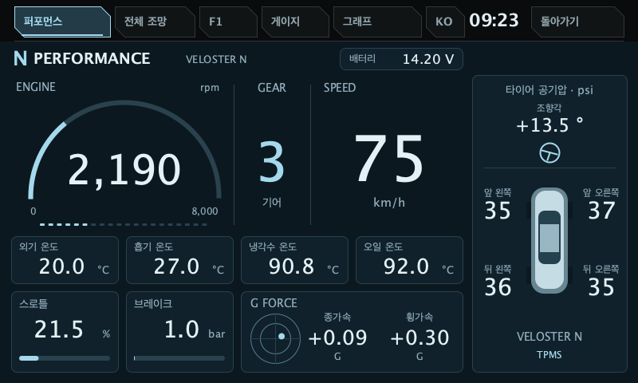
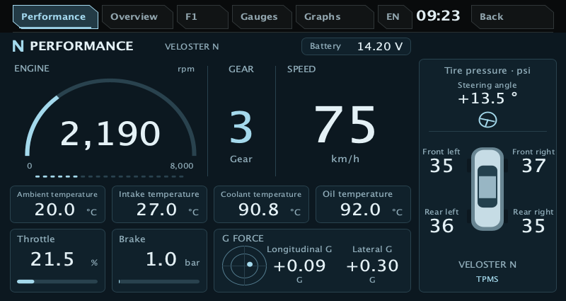

# Performance dashboard / 퍼포먼스 계기판

[Documentation](README.md) · [Verification status](STATUS.md)

**Unreleased source candidate, 2026-11-02.** Select **Performance / 퍼포먼스** at the top left. Overview, F1, Gauges and Graphs remain available. The last selected page is saved; a fresh installation still starts on Overview. Back and language controls keep their existing positions.



This is the actual Canvas renderer with **synthetic test values**, rendered on the host at 800×480. It is not a vehicle screenshot. The layout was inspired by the owner's supplied navigation-info reference; the drawing is implemented in this project's Java source with a simple vector car silhouette. No reference bitmap or third-party UI code is bundled.

- RPM, manual forward gear, speed, ambient/intake/coolant/oil temperatures.
- Throttle %, brake pressure in bar, longitudinal/lateral G, battery voltage.
- Four individually received TPMS pressures in psi and steering angle, using the existing steering display sign.
- All 17 numeric readings use the existing telemetry validity and expiry rules. Missing, invalid or expired readings show `—`; missing G/steering readings do not produce a centered live indicator. The RPM scale's printed zero is a scale label, not a received reading.

The RPM arc uses 0–8,000 rpm, pedal bars use 0–100 % / 0–100 bar, and the G dot uses ±1 G per axis. Bars/dot clamp visually; numeric readings retain their values. These are visual scales, not new protocol limits or warnings. The reference's automatic-transmission `D`, SPORT mode and transmission-fluid temperature were not added because this vehicle's existing verified model does not supply them.



Host verification covers Korean/English at 800×480 and 800×425, received/waiting/expired/invalid data, all five page hit targets, and rendering of the four prior pages. Host fonts and rasterization approximate Android; target fonts, performance and touch behavior still require vehicle verification. Existing display restrictions remain in force.

Reproduce the preview with JDK 17 available:

```sh
python3 tests/test_performance_renderer.py --out build/performance-preview
```

Implementation: [PerformanceRenderer](../apps/dashboard/src/main/java/com/veloster/dashboard/view/performance/PerformanceRenderer.java), [DashboardPage](../apps/dashboard/src/main/java/com/veloster/dashboard/view/DashboardPage.java), [DashboardView](../apps/dashboard/src/main/java/com/veloster/dashboard/view/DashboardView.java). Fixtures are confined to tests. No new vehicle command or telemetry decoding was introduced.

## 한국어

기존 화면을 유지하며 선택 가능한 **퍼포먼스** 탭을 추가했습니다. 마지막 선택 화면을 저장하고, 처음에는 기존 전체 조망으로 시작합니다. 실제로 받는 값만 표시하며 미수신·무효·만료 값은 `—`로 표시합니다. 위 이미지는 실제 그리기 코드에 합성 시험값을 넣은 PC 미리보기입니다. 새 소스는 실차 미설치·미검증이며 기존 배포 APK와 구분합니다.
