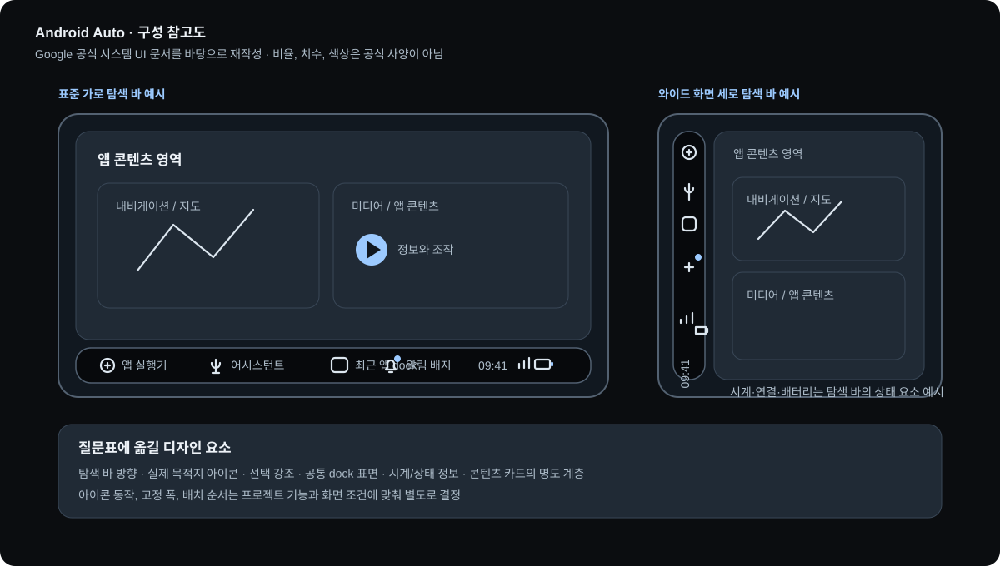

# 테마 생성 질문표

- 목적: 사용자 의도와 참고자료를 엔진이 지원하는 테마 선택으로 연결한다.
- 적용 기준: 현재 테마 엔진 v3와 실제 schema/runtime 계약
- 연동 문서: [테마 엔진 v3](theme_engine_v3.md), [Material 3·Android Auto 리서치 규격](MATERIAL_AUTO_THEME_RESEARCH_SPEC_20261119.md)
- 상태: 작성용 기준 문서. 기입한 답은 디자인 승인이나 구현·기기 검증 완료를 뜻하지 않는다.

## 작성 원칙

이 질문표는 Android Auto나 Material 화면을 복제하기 위한 것이 아니다. 사용자가 지정한 시각 언어와 참고자료를 이 Dashboard의 기존 기능·화면 구조에 맞춰 독립 테마로 만든다. 참고 UI의 기능을 이 프로젝트가 제공하지 않으면 아이콘과 동작을 흉내 내지 않는다.

새 테마는 별도 theme ID와 파일로 자체 색상·형태·타이포그래피·배치 스타일을 선언한다. 기존 Original의 외형을 테마 상속으로 가져오지 않는다. 각 테마의 Overview는 5열×4행, 한 화면으로 고정한다. 이 규칙은 질문이나 선택 항목이 아니다.

각 응답에는 선택값, 근거, 상태를 기록한다. 상태는 **미정**, **제안**, **확정**, **해당 없음**, **엔진 확장 필요** 중 하나를 쓴다. 엔진에 없는 속성은 지원되는 것처럼 질문하거나 JSON에 임의로 추가하지 않는다.

## 참고자료와 시각 근거

스타일, 이미지, 명확한 출처를 참고자료에 넣으면 출처 링크와 이미지 출력물을 함께 남긴다. 이미지는 문서에서 바로 볼 수 있게 첨부 파일을 저장소에 두고 상대 경로로 삽입한다. 출처 페이지·이미지 원본 URL, 작성자/게시자, 자료 제목, 확인 날짜, 사용 범위나 라이선스를 같이 기록한다. 저작권·라이선스를 확인하지 못한 이미지의 경우 임의로 저장소에 복제하지 말고 출처 페이지 링크와 직접 확인 가능한 이미지 미리보기를 제공한다.

아래 구성도는 Google 공식 Android Auto 시스템 UI 문서를 읽기 쉽게 다시 그린 참고도이며, 공식 스크린샷이나 픽셀·치수 규격이 아니다. Android Auto는 하단 또는 측면 탐색 바에 앱 실행기, 어시스턴트, 앱 dock, 알림 배지를 둘 수 있다. 시계·날씨·연결·배터리는 탐색 바의 상태 요소 또는 별도 상태 표시줄 구성으로 나타날 수 있다. 실제 방향과 순서는 화면과 차량 구성에 따라 달라진다.

[Google 공식 Android Auto 시스템 UI 개요](https://developers.google.com/cars/design/android-auto/product-experience/system-ui/overview) · [탐색 바 구성](https://developers.google.com/cars/design/android-auto/product-experience/system-ui/nav-bar) · [상태 표시줄 구성](https://developers.google.com/cars/design/android-auto/product-experience/system-ui/status-bar)

이미지별 기록:

| 항목 | 기록 |
|---|---|
| 문서 내 이미지 | `images/android-auto-ui-reference.svg` |
| 이미지 성격 | 공식 자료를 바탕으로 다시 그린 설명용 구성도 |
| 1차 출처 | [Google for Developers · Android Auto System UI](https://developers.google.com/cars/design/android-auto/product-experience/system-ui/overview) |
| 함께 볼 출처 | [Navigation bar](https://developers.google.com/cars/design/android-auto/product-experience/system-ui/nav-bar), [Status bar](https://developers.google.com/cars/design/android-auto/product-experience/system-ui/status-bar), [Widgets](https://developers.google.com/cars/design/android-auto/product-experience/system-ui/widgets) |
| 출처 표기 | Google Developers 문서는 별도 표시가 없는 한 CC BY 4.0. 이 SVG는 문서 설명을 바탕으로 새로 그린 구성도이며 Google 화면 캡처를 포함하지 않음 |
| 확인일 | 2026-11-19 |
| 적용 경계 | 시각적 요소와 계층만 참고. 위치, 치수, 동작을 Dashboard 규격으로 간주하지 않음 |

## 질문표

| 구분 | 질문 | 응답에 기록할 것 | v3 연결 및 제약 |
|---|---|---|---|
| 목표 | 테마 이름과 만들려는 분위기는 무엇인가? | theme ID, 표시명, 한 문장 콘셉트, 사용 환경 | manifest와 catalog 규칙 확인 |
| 참조 범위 | 참고자료에서 가져올 시각 요소는 무엇인가? | 색, 대비, 표면, 도형, 글꼴, 아이콘 스타일, 정보 위계별로 출처 지정 | 기능 복제와 시각 참고를 구분 |
| 화면 | 어떤 화면을 설계하는가? | Overview, F1, 게이지, 그래프, 퍼포먼스, 설정, 진단 중 대상 | 각 화면별 JSON 역할 및 schema 확인 |
| Overview | 20개 항목을 어떤 우선순위로 보여줄까? | 카드 ID/source, 배치 순서, span, 생략할 항목 | 5×4 단일 화면 고정. 4×3·페이지 이동 금지 |
| 메뉴 필요성 | 항상 보이는 페이지 메뉴가 필요한가? | 필요 여부, 표시할 실제 페이지, 보조 진입점 | 메뉴 기능과 hit area는 기존 동작 유지 |
| 메뉴 위치·폭 | 상단과 왼쪽 중 어디에 둘까? 왼쪽이면 폭과 여백은? | 위치, 폭, 정렬, 상하좌우 padding, 선택 상태 | shell의 position·width·alignment·padding. 지원 범위와 화면 공간 검사 |
| 메뉴 외형 | 버튼형인가, 공통 배경의 dock형인가? | buttons/dock, 공통 배경·버튼 배경, 밑줄/선택 강조 | dock은 왼쪽 메뉴에만 지원. navigationAppearance·surfaceStyles·fills·decorations |
| 메뉴 요소 | 시계·페이지 아이콘·설정·돌아가기를 어떻게 보일까? | 실제 기능이 있는 요소, 순서, 아이콘 굵기/크기/선택 표시 | 런처·마이크·알림 등 미지원 동작을 가짜로 표현하지 않음. 아이콘별 자산 설정 지원 여부 확인 |
| 색상 | 바탕·표면·전경·강조·상태색은 무엇인가? | 역할별 색상, 주야간 대비, 선택·비활성·경고·위험·미수신 예 | colors schema의 의미 토큰 사용. 상태 의미는 데이터·렌더러 계약 보존 |
| 배경 | 단색·그라데이션·무늬·이미지 중 무엇을 쓸까? 기본 배경은 포인트 컬러에 연동할까? | 기본 배경, 이미지/썸네일, 색상별 변형, 자르기 의도, 수동 선택 우선순위, 텍스트 가독성 | backdrop·assets.background·wallpapers. 엔진별 accent-linked default는 명시적 palette key로 연결하고 사용자 지정 배경은 우선 보존한다. 파일 형식과 경로 schema 준수 |
| 표면 재질 | 카드·메뉴·패널마다 어떤 면 처리를 쓸까? | flat/glass/legacy 역할 매핑, 투명도·블러·하이라이트 | material·surfaceStyles·surfaceBlur. Glass 설정이 없는 역할에는 효과를 가정하지 않음 |
| 모서리와 테두리 | 카드·메뉴·버튼·화면 외곽의 radius와 테두리는 어떤 스타일인가? | 곡선(circle/squircle), 반경, 외곽선 색/존재, 각 표면의 예시 | shell의 screenCorner/screenCornerRadius, material.radius, F1 전용 radius, colors.stroke 확인. 독립 border 두께·요소별 radius가 schema/runtime에 없으면 엔진 확장 필요 |
| 간격·치수 | 버튼 크기, 카드 padding, grid gap과 본문 여백은? | 논리 단위 값, 사용 화면 크기, 밀집/여유의 우선순위 | spacing 및 화면별 layout schema 범위 안에서 지정 |
| 타이포그래피 | 숫자·본문·기어의 글꼴과 위계를 어떻게 나눌까? | 글꼴 출처/라이선스, weight, 크기 배율, 한글·숫자 검토 | fonts와 typography schema. API 17 로드·글리프·fallback 확인 |
| 미디어·위젯 | 미디어 바와 앨범 영역을 어떻게 보일까? | 공통 바 배경, 버튼별 배경, 화면별 표시 밀도 | mediaFooter·mediaControls와 공통 표시 설정 분리 |
| 상속·독립성 | 새 테마의 스타일을 어떻게 자체 선언할까? | 자체 선언 파일 목록과 신규 ID | 이번 작업의 신규 테마는 extends 없이 자체 선언 |
| 검수 | 어떤 화면·상태·언어·크기에서 확인할까? | 800×480, 지원 변형, 한/영, 기본·선택·경고·무효·미수신, 대비 | 실제 renderer 프리뷰, schema/runtime 검사, 합성 데이터 표기. Android/실차 결과와 호스트 결과 분리 |

## 기록 양식

아래 표를 테마별로 복사해 질문에 답한다. 미정 항목은 합리적 제안과 미정 이유를 적고, 사용자의 확정 전에는 승인된 디자인으로 표시하지 않는다.

| 항목 | 답변/선택 | 상태 | 근거·이유 | 엔진/schema 위치 | 참고 링크·이미지 |
|---|---|---|---|---|---|
| 테마 ID/이름 |  | 미정 |  | manifest/catalog |  |
| 참조 범위 |  | 미정 |  | 해당 없음 또는 관련 역할 |  |
| 메뉴 위치/폭/dock |  | 미정 |  | shell, components |  |
| 색상/상태색 |  | 미정 |  | colors |  |
| 배경/벽지 |  | 미정 |  | colors, components assets |  |
| 표면/radius/테두리 |  | 미정 |  | components, shell, 화면 schema |  |
| 글꼴/크기 |  | 미정 |  | fonts |  |
| 간격/화면 배치 |  | 미정 |  | 화면별 layouts |  |
| 검수 범위 |  | 미정 |  | preview/tests |  |

## 엔진 지원 상태 기록

모든 질문은 아래 중 하나로 분류한다.

| 상태 | 뜻 | 작성·진행 규칙 |
|---|---|---|
| 지원 | 현재 schema와 실제 런타임이 읽고 그린다 | 파일/속성 및 유효 범위를 질문표에 적는다 |
| 조합 가능 | 한 전용 속성은 없지만 기존 역할·토큰 조합으로 표현 가능하다 | 조합법과 제약을 명시하고 런타임 결과를 확인한다 |
| 고정 규칙 | 사용자 선택을 받지 않는 공통 계약이다 | 질문으로 열지 않고 규칙과 검수 항목에 둔다 |
| 엔진 확장 필요 | schema, 파서/ThemeSpec, 렌더러, fallback 또는 테스트 중 필요한 지원이 없다 | 선택 가능한 기능처럼 제시하지 않는다. 별도 엔진 변경 제안과 승인을 거친 뒤 질문 항목을 활성화한다 |
| 미확인 | 문서와 코드의 지원 여부가 일치하는지 확인되지 않았다 | 코드를 확인하기 전에는 선택을 확정하지 않는다 |

예: 현재 v3에는 재질별 공통 radius와 화면 외곽 곡선 설정이 있다. 그러나 테두리 두께를 표면마다 독립 지정하는 필드는 확인되지 않았다. 따라서 radius는 지원 항목으로 묻고, 개별 border 두께는 엔진 확장 필요로 표시한다. 이 구분은 실제 schema와 구현이 바뀌면 다시 검증한다.

## 동기화 규칙

질문표는 고정된 독립 체크리스트가 아니라 테마 엔진의 작성 인터페이스다. 다음 파일이나 동작이 바뀌면 같은 변경 작업에서 질문표를 검토하고 갱신한다.

1. `theme_engine_v3.md` 또는 후속 엔진 규격의 필드·허용값·기본값·제약·화면 계약
2. `theme/manifest.schema.json`, `theme/schema/*.schema.json`의 필드·범위·enum
3. ThemeSpec/ThemeCatalog의 파싱·상속·검증·fallback 동작
4. ThemeSurface와 화면 renderer의 표면·색상·radius·테두리·레이아웃 적용
5. 테마 생성·미리보기·검증 절차와 결과물 형식

변경 시 순서는 다음과 같다.

1. 코드와 schema를 확인해 실제 지원 계약을 갱신한다.
2. 질문표의 관련 질문, 예시 답, 지원 상태, 제약을 함께 수정한다.
3. 새 필드를 추가하면 지원 여부와 유효 범위, 검수 질문을 같은 변경에 넣는다.
4. 필드가 삭제·폐기되면 선택지에서 제거하고 마이그레이션/대체 경로를 적는다.
5. 이 문서와 양방향 링크를 유지하는 [테마 엔진 v3](theme_engine_v3.md), [리서치 규격](MATERIAL_AUTO_THEME_RESEARCH_SPEC_20261119.md), [문서 색인](README.md)을 확인한다.
6. 완료 기록에는 함께 검토한 schema·코드와 수행한 문서 링크/이미지 검사를 남긴다.

새 질문을 추가했는데 schema/runtime을 바꾸지 않았다면 **엔진 확장 필요** 또는 **미확인**으로 남긴다. 반대로 새 schema 필드를 추가하면서 질문표를 검토하지 않은 엔진 변경은 동기화 완료로 보지 않는다.

## 현재 예시 테마 자료

이 저장소의 `material_auto_cowork`는 질문표를 채울 때 참고할 수 있는 시안이다. 이 값들은 공통 기본값이나 사용자의 사전 승인으로 취급하지 않는다. manifest는 부모 테마를 상속하지 않으며, Overview는 자체 5×4 단일 화면으로 선언한다.

- [테마 리서치·구현 규격](MATERIAL_AUTO_THEME_RESEARCH_SPEC_20261119.md)
- [테마 구현 기록](MATERIAL_AUTO_THEME_IMPLEMENTATION_20261119.md)
- [테마 자산: catalog 및 manifest](../apps/dashboard/src/0x1101L/assets/themes/catalog.json)
- [테마 색상](../apps/dashboard/src/0x1101L/assets/themes/material_auto_cowork/colors.json)
- [테마 재질·간격·배경](../apps/dashboard/src/0x1101L/assets/themes/material_auto_cowork/components.json)
- [테마 메뉴·shell](../apps/dashboard/src/0x1101L/assets/themes/material_auto_cowork/layouts/shell.json)
- [테마 글꼴·타이포그래피](../apps/dashboard/src/0x1101L/assets/themes/material_auto_cowork/fonts.json)

새 테마 작업 때 이 문서를 작성하고, 확정된 답과 참고 이미지/출처를 구현 보고서에 연결한다.
