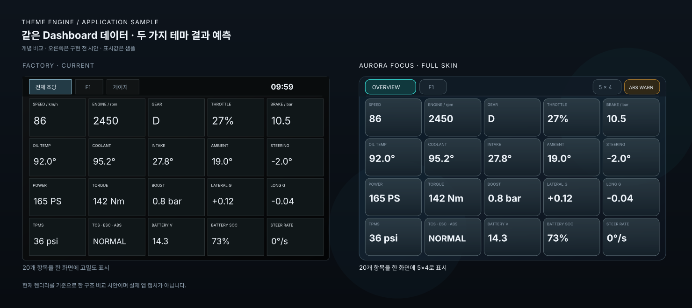

# 테마 엔진 적용 예상 샘플 — Aurora Focus

- 기준 브랜치: `dev-theme` (현재 `origin/dev` @ `4e43133`, 초기 조사 기준 `8c20449`)
- 목적: 완성형 테마 하나를 적용했을 때 보이는 차이와 필요한 수정 범위를 검토한다.
- 상태: 디자인/구조 제안. 런타임 테마 엔진과 아래 패키지 포맷은 아직 구현되지 않았다.

## 샘플 테마가 바꾸는 결과

`Aurora Focus`는 단순 색상 스킨이 아니다. 배경, 카드 표면, 글자, 반경, 간격을 바꾸는 테마 예시다. 기본 테마는 현재 화면을 유지하고, Aurora 선택 시 아래처럼 바뀐다고 가정한다. 초기 초안의 4×3/두 페이지 안은 폐기했으며, 현재 테마 규칙은 고정 5×4 단일 Overview다.



| 항목 | 현재 Original | Aurora Focus 예상 |
|---|---|---|
| 배경/재질 | 어두운 gradient와 어두운 패널 | 남청 배경 이미지 또는 gradient, 얕은 scrim, 반투명 느낌의 카드 표면과 얇은 하이라이트 |
| 그리드 | 전체 조망 5열×4행, 카드 147×98, 간격 8×6px | 전체 조망 5열×4행 단일 화면, 20개 슬롯 안에서 동일한 신호를 표시하고 간격·타이포그래피로 위계를 조정 |
| 숫자/글자 | 현행 기본 Typeface와 화면별 고정 크기 | 숫자는 더 크고 굵게, 라벨은 작은 대문자/보조색, 단위는 별도 정렬. 한글 라벨 fallback은 유지 |
| 모서리/선 | 절단형 공통 패널과 페이지별 radius 5–10px | overview 카드 14px, 컨트롤 10px, 상태 칩 8px/pill. 테두리 1px, 선택/경고만 강조선 |
| 강조/상태 | 청색 계열 강조, 일부 경고색 | 청록 강조, amber 경고. 색 외에 텍스트/아이콘도 유지해 상태를 구별 |
| 동작 | 현재 탭, 게이지/그래프 편집 및 신호값 | 같은 기능과 같은 데이터 해석. Overview 페이지 이동은 없다 |

테마별 그리드 변경은 허용하지 않는다. 신호 ID와 profile별 그룹(TPMS 또는 JS 연비 등)은 화면 좌표와 분리해 유지하고, 모든 테마에서 20개 슬롯을 단일 5×4 화면 안에 표시한다.

## 패키지 정의 예시

아래 JSON은 의도를 보이기 위한 샘플 포맷이다. 실제 메타데이터 키, API 17 리소스 접근 방식, 허용 값 범위는 APK 계약 조사와 구현에서 확정해야 한다. `assets/` 파일은 예시 이름이며 저장소에 포함되거나 앱에서 읽히는 리소스가 아니다.

별도 파일: [Aurora Focus 샘플 매니페스트](theme-samples/aurora-focus-v1.sample.json).

```json
{
  "sampleOnly": true,
  "id": "joylab.aurora-focus",
  "name": "Aurora Focus",
  "themeSpecVersion": 1,
  "assets": {
    "background": {
      "resource": "assets/aurora-night-texture.png",
      "fit": "cover",
      "scrim": "#9906111B"
    },
    "font": {
      "family": "system-sans",
      "fallback": "android-default"
    }
  },
  "colors": {
    "canvas": "#071019",
    "surface.card": "#CC17232D",
    "surface.cardEdge": "#667C909C",
    "text.primary": "#F4F8FB",
    "text.secondary": "#A8B8C5",
    "accent.primary": "#35D8D0",
    "state.warning": "#FFB547",
    "state.critical": "#FF5D6C",
    "state.unavailable": "#82909B"
  },
  "shape": {
    "overviewCardRadius": 14,
    "controlRadius": 10,
    "statusRadius": 8,
    "borderWidth": 1
  },
  "typography": {
    "caption": 11,
    "label": 13,
    "value": 34,
    "heroValue": 46,
    "strongWeight": true
  },
  "layouts": {
    "overview": {
      "profile": "fixed-5x4",
      "columns": 5,
      "rows": 4,
      "gap": { "x": 12, "y": 10 },
      "margin": { "left": 16, "right": 16, "top": 10, "bottom": 8 },
      "cards": ["speed", "engine_rpm", "gear", "throttle", "brake_pressure", "oil_temp", "coolant_temp", "intake_temp", "ambient_temp", "steering_angle", "power_est", "torque_est", "boost_est", "lateral_g", "longitudinal_g", "tpms_or_fuel_group", "tcs_esc_abs_group", "battery_voltage", "battery_soc", "steering_rate"]
    }
  }
}
```

숫자 크기·색상은 역할별 토큰의 예시값이다. 생산 규격에서는 숫자만 받지 말고 논리 단위, 허용 범위, 누락 기본값, 폰트 라이선스, 이미지 최대 크기/형식, profile별 필수 신호를 정의한다. background 이미지는 로딩 실패 시 canvas 색/gradient로 대체한다.

## 어떤 코드를 바꿔야 하는가

| 수정 영역 | 현재 상태 | 필요한 작업 |
|---|---|---|
| 테마 계약/저장 | theme package 파서와 선택 상태가 없음 | `ThemePackage`, `ThemeSpec`, `ThemeLayout`, 규격 검사기, 기본 테마 fallback, 선택값 저장소를 추가한다. APK 내보내기 리소스·패키지 삭제/업데이트 처리도 포함한다. |
| Dashboard 진입/프레임 | `DashboardView`가 `PitRenderer` 또는 `JsPitRenderer`를 선택해 화면 크기·Telemetry·페이지 상태를 전달 | 현재 선택 테마를 준비하고 렌더 호출에 전달한다. 배경/폰트/이미지 I/O는 draw loop 밖에서 끝낸다. |
| 공통 화면/Canvas 스타일 | `PitRenderer`와 `JsPitRenderer`에 BG/PANEL/LINE/BLUE 상수와 panel/button/text 도우미가 중복 | 도우미를 테마 값 기반으로 바꾸고 자산 캐시/배경 renderer를 둔다. 기존 기본 테마 픽셀 결과가 바뀌지 않는지 비교한다. |
| 페이지별 렌더러 | Overview, Gauge, Graph, F1/Cluster, Performance, Diagnostics에서 Paint 색·radius·문자 크기를 직접 사용 | 각 렌더러에 ThemeSpec을 전달하고 의미별 색·형상·타이포 토큰을 적용한다. 0x1101L 전용 진단 화면도 누락 없이 포함한다. |
| 페이지 레이아웃 | `OverviewLayout`, `GaugeLayout`, `GraphLayout`이 좌표·열/행·크기를 코드에 고정. overview hit-test도 같은 고정 좌표 계산 | `ThemeLayout`으로 간격을 공급한다. Overview는 5×4 단일 화면으로 고정하고 렌더와 hit-test가 동일 geometry를 쓴다. |
| 사용자 편집 상태 | Gauge/Graph 설정이 별도 SharedPreferences에 저장 | 신호 선택과 스타일/위치가 테마 변경 후에도 어떻게 유지될지 migration/override 정책을 정의한다. theme default와 사용자 override를 분리 저장한다. |
| 자산/폰트 | 앨범아트 `ArtworkLoader`는 존재하나 테마 자산 로더는 없음 | 별도 `ThemeAssetLoader`로 package resources를 조회/검증/캐시한다. fallback, 손상 파일, 미지원 폰트 글리프를 처리한다. |
| 프리뷰 | 현재 테마 draft를 넣는 실시간 테마 프리뷰 없음 | PreviewTelemetry fixture + 현재와 같은 renderer + 임시 ThemeLayout으로 샘플/상태를 즉시 그린다. 프리뷰 중 운영 테마와 저장된 사용자 설정을 쓰지 않는다. |

## 구현 결과를 판정할 기준

1. 기본 테마 선택 시 현재 800×480 전체 화면 캡처와 비교해 배치·색·문자 크기·동작이 의도치 않게 달라지지 않는다.
2. Aurora 선택 시 배경·surface·폰트·반경·간격이 시안처럼 바뀌고, 고정 5×4 화면에서 현재 overview 항목을 모두 찾을 수 있다.
3. 같은 telemetry fixture를 두 테마에 넣었을 때 값·단위·유효/무효/미수신·warning 판정은 같고 표현만 달라진다.
4. 게이지/그래프 사용자 변경값을 유지할지 테마 기본 레이아웃을 우선할지 정책이 결정되고, 테마 변경/삭제/복귀에서 일관된다.
5. 한국어/영어 라벨, 긴 숫자, 경고, 밝은 배경 자산, 자산 누락, 저사양 성능을 확인한다. PC 프리뷰와 API 17 실제 기기 결과는 별도로 기록한다.

이 문서는 적용 전 결과를 예측한 설계 샘플이다. 테마 엔진 구현, APK에서의 자산 로딩, API 17 렌더링, 터치 및 차량 실기 검증은 수행되지 않았다.
