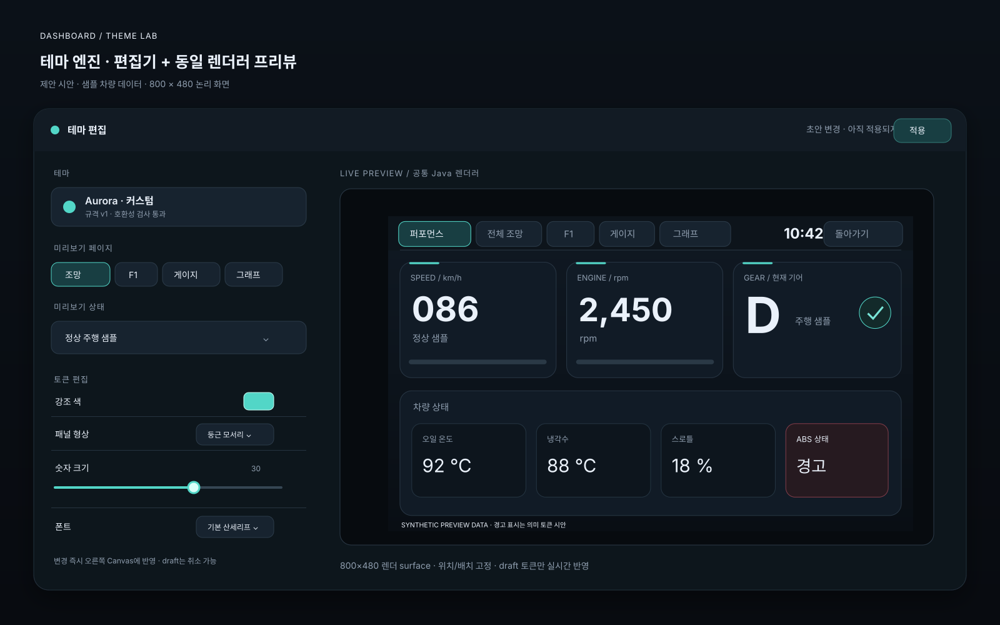
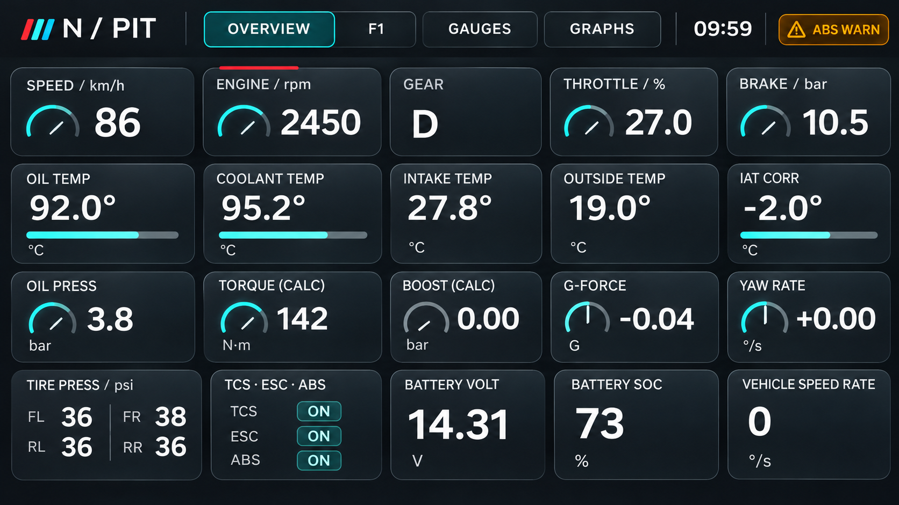

# Dashboard 테마 엔진 조사·설계 보고서

- 작성일: 2026-11-17 (KST)
- 작업 브랜치: `dev-theme` (최신 동기화 기준: `origin/dev` @ `4e43133`; 기존 코드 조사 기록은 당시 기준 `8c20449`)
- 범위: 코드 구조 조사, 테마 적용 계약 제안, 프리뷰 설계와 예상 시안
- 상태: 조사·제안. 테마 엔진 코드, 테마 APK, 기기 표시를 구현하거나 검증한 결과가 아니다.

## 결론

기본 테마는 현행 화면을 픽셀 비교 기준으로 유지한다. 사용자가 선택한 별도 테마는 배경부터 패널·카드·폰트·아이콘·여백·그리드·페이지 구성까지 바꾸는 완성형 스킨이 될 수 있어야 한다. 색상만 바뀌는 얇은 팔레트 교체로 제한하지 않는다. 단, 화면 해상도와 차량 데이터의 값·단위·유효성·경고 판정, 조작 기능은 테마 계약과 분리한다. 별도 테마는 기존 신호와 동작을 유지한 채 페이지별 레이아웃을 바꾼다.

미리보기는 편집 화면에서 선택 중인 번들 `ThemeSpec`을 즉시 같은 Java 렌더러에 적용한다. 데모 `Telemetry`/고정 시각 샘플을 읽기 전용으로 공급하고 실차 수신기·차량 명령·사용자 게이지 배치를 수정하지 않는다. v1 프리뷰는 Dashboard APK에 포함된 검증된 리소스만 대상으로 하며, PC 프리뷰는 API 17 기기 호환이나 실차 성능을 대신 증명하지 않는다.

제조사별 실제 헤드유닛 자료의 정보 구조와 Dashboard 800×480 적용 후보(폰트 위계·갭·치수·비율)는 [차량 제조사 UI 분석 보고서](HEAD_UNIT_UI_ANALYSIS_20261117.md)에 별도로 정리했다. 제조사가 공개하지 않은 글꼴명이나 원본 픽셀 수치는 추정값으로 단정하지 않고, 공식 구조 관찰과 적용 후보를 구분한다.

## 현재 코드에서 확인한 사실

| 영역 | 확인 근거 | 테마 엔진에 미치는 영향 |
|---|---|---|
| 공통 화면 골격 | `apps/dashboard/src/main/java/com/veloster/dashboard/view/PitRenderer.java`, `JsPitRenderer.java` | 두 렌더러가 배경, 상단 탭, 패널/버튼 및 하위 페이지 선택을 직접 그린다. 색 상수와 `Paint` 설정이 렌더러에 있다. |
| 화면별 렌더 | `view/overview/*Renderer.java`, `view/gauge/*Renderer.java`, `view/graph/GraphRenderer.java`, `view/f1/*Renderer.java`, `view/performance/*Renderer.java`, `0x1101L/.../JsDiagnosticsRenderer.java` | 전체 외형을 바꾸려면 공통 스타일과 화면별 레이아웃 전략이 함께 테마화되어야 한다. 색상 숫자만 치환해서는 완성형 스킨이 되지 않는다. |
| 형상 | Pit/Overview 패널은 절단 다각형. 게이지 카드는 `drawRoundRect` 반경 10, 그래프 행은 7, 선택 칩은 5 사용 | `cornerRadius` 단일 숫자로 합칠 수 없다. `cut-corner`, `square`, `rounded(small/medium/large)` 같은 형상 의미를 제공한다. |
| 폰트 | 렌더러가 `Typeface.DEFAULT`/`DEFAULT_BOLD`, 여러 고정 `setTextSize` 값과 `measureText` 기반 축소를 사용 | 역할별 폰트·크기·굵기 토큰으로 모은다. 외부 폰트 적용 후 폭 측정과 기존 축소/잘림 방지 로직을 재검증한다. |
| 레이아웃·사용자 상태 | `DashboardView`, `GaugeLayout`, `GraphLayout`, `GaugeEditor`가 화면·신호·스타일·위치 및 설정값을 별도 보유 | 기본 테마는 현재 배치를 보존한다. 별도 테마는 페이지 템플릿/그리드를 바꿀 수 있어야 한다. 저장된 게이지 배치와 테마 템플릿의 우선순위는 구현 전 정한다. |
| 렌더 축척 | `PitRenderer`/`JsPitRenderer`가 화면 크기를 800×480 기준으로 변환 | 토큰의 치수 단위는 논리 좌표 기준으로 정의한다. 실제 종횡비·기기 표시 영역은 별도 실기 검증 대상이다. |

전체 UI의 토큰 전수 목록은 아직 만들지 않았다. 위 화면은 확인된 주요 Canvas 경로이며 다른 메뉴, OEM 표면, 비 Canvas View, 0x1101L 전용 화면의 포괄성을 주장하지 않는다.

## v1 적용 범위 제안

| 토큰 그룹 | v1에 넣을 항목 | 경계와 기본값 원칙 |
|---|---|---|
| 배경·표면 | 단색/그라데이션, 정적 이미지·텍스처, 패널 표면, 투명도, 테두리, 하이라이트 | 배경 자산과 crop/fit 방식을 테마에서 지정할 수 있다. 외부 실행 코드는 읽지 않는다. API 17에서 무거운 blur 대신 정적 자산과 알파 레이어를 쓸 수 있다. |
| 색상·상태 | `canvas.background`, `surface.panel`, `surface.panelRaised`, `stroke.subtle`, `text.primary`, `text.secondary`, `accent.primary`, `state.warning`, `state.critical`, `state.unavailable`, `data.series.1..N` | 의미별 색을 유지하고 경고·무효·미수신은 문자/표식도 보존한다. 대비 기준을 둔다. |
| 투명도·효과 | 알파, gradient, 정적 재질 효과, 애니메이션 후보 | blur/refraction/animation은 미리 제외하지 않고 API 17 성능과 시인성 측정 후 지원 여부를 결정한다. 저사양 fallback이 필요하다. |
| 선·테두리 | 외곽선 색, 두께, 선택 강조선, 차트 격자/축 색 | 테마 레이아웃에 맞춰 그리되 터치 hit 영역도 같은 레이아웃에서 산출한다. 너무 가는 실기 선과 조작 영역은 800×480 기준에서 검사한다. |
| 형상·간격 | `shape.panel/card/control`, `radius.*`, 페이지 여백·카드 간격·내부 패딩 | 각 테마가 프리셋 또는 선언형 페이지 레이아웃으로 조정할 수 있다. 기본 테마는 현행값을 재현한다. |
| 레이아웃 | 페이지 템플릿, 열/행 수, 카드 크기·위치, 노출 우선순위, overflow/페이지 전환 | 별도 테마가 바꿀 수 있는 완성형 스킨의 일부다. 지원하지 않는 선언은 안전하게 기본 레이아웃으로 fallback한다. |
| 타이포그래피 | `font.family.body`, `.numeric`, `font.size.caption/body/label/value/headline`, `font.weight.regular/strong`, 숫자 정렬/letter spacing(지원 확인 후) | 크기는 800×480 논리 좌표의 sp 유사 값으로 정의하고 디스플레이 축척에 함께 반영한다. 자동 축소는 하한을 두고 긴 값/한국어/단위 표본으로 검사한다. |
| 자산 | 배경 이미지/텍스처, 아이콘·장식 리소스, 폰트 | 정적 리소스만 허용하고 실행 코드는 로드하지 않는다. 누락/손상/미지원 글리프는 내장 리소스/폰트로 대체한다. 라이선스·크기·형식 제한을 계약에 둔다. |

테마 교체의 목표는 배경과 전체 화면 표현까지 바꾸는 것이다. 구현은 `ThemePackage`(정적 자산·토큰·페이지 레이아웃)와 검증된 `ThemeSpec`(렌더러가 사용하는 값)으로 나누는 안을 제안한다. 기본 테마만 현행 픽셀 기준을 지키고, 별도 테마는 자체 그리드와 카드 구성을 가질 수 있다. 신호 의미·표시값·단위·유효성·경고 판정과 조작 동작은 바꾸지 않는다. 사용자가 편집한 게이지/그래프 배치와 테마 레이아웃의 우선순위는 미결이다. 공통 렌더러와 JS/JSN 화면 복제 원칙 사이의 충돌도 구현 전에 정리한다.

### 간격·그리드·모서리 후보

아래는 현행 코드에서 읽은 기준값과 테마/밀도 설정으로 고려할 후보를 구분한 것이다. 좌표 단위는 모두 800×480 논리 화면 픽셀이다.

| 화면 | 현행 배치·간격 | 기준 모서리 |
|---|---|---|
| 전체 조망 | 5열, 카드 147×98, X pitch 155 → 가로 여백 8, Y pitch 104 → 세로 여백 6. 시작점 (18, 58). | 패널은 반경형이 아니라 모서리를 12px 잘라낸 다각형. |
| 게이지 기본 | 3열, 카드 252×190, X pitch 262 → 간격 10, Y pitch 198 → 간격 8. 시작점 (12, 80). | 반경 10. |
| 게이지 촘촘히 | 4열, hit 영역 188×124, pitch 196×132. 실제 그려지는 252×190 카드가 0.653배 축소되어 약 164×124가 되므로 카드 사이 시각 간격은 약 32. hit 영역 사이 간격 8과 다르다. | 그려지는 카드의 반경도 같은 비율로 축소되어 약 6.5. |
| 그래프 | 3행, 각 행 764×124, X 여백 18, Y pitch 130 → 세로 간격 6. | 반경 7. |
| 성능 화면 | 여러 카드/표면이 화면별로 혼재. | 공통 패널 반경 7 외에 작은 게이지/막대 장식 반경 1–16이 있음. 화면 전수 분류 필요. |

**간격·그리드 후보군:** 내부 간격 척도 `2 / 4 / 8 / 12 / 16`에 더해 페이지 단위 `ThemeLayout` 프로필을 둔다. 프리뷰 후보는 `Original`(현행 5×4·8/6px 간격), `Focus`(핵심 카드 확대, 나머지는 추가 페이지), `Dense`(작은 카드로 더 많은 동시 노출), `Airy`(큰 여백과 적은 동시 노출)다. 수치와 페이지별 정보 매핑은 시안 후보이며 아직 구현 계약이 아니다. 카드만 키워 기존 신호를 숨기지 않도록 전체 신호 수·overflow·페이지 전환을 함께 설계한다.

**Border radius 후보군:** 일반적인 선택 척도는 `0 / 4 / 8 / 12` 논리 px, pill형은 상태 칩 전용 `pill`로 제한하는 안이 적절하다. 테마 편집에서는 모든 요소에 하나의 radius를 강제하지 않고 `shape.panel`, `radius.card`, `radius.control`, `radius.status`로 나눈다. 프리셋 후보는 `Original`(현행 절단 패널 + 10/7/5px 화면별 반경), `Crisp`(각진 사각), `Soft`(카드 8, 컨트롤 6, 칩 6), `Glass`(카드 12, 컨트롤 10, 칩 8, 상태 칩 pill)이다. `Original`만 기준선 보존 후보이며 나머지는 시안 단계로, 대비·모서리 겹침·글자 잘림·실기 가독성을 확인하기 전 확정값이 아니다.

현재 코드에는 기준 간격/크기/반경 숫자가 있고, 문서에는 완성형 테마의 스타일·레이아웃 프리셋 후보를 제안했다. 앱에는 아직 선택 가능한 테마 엔진이 구현되어 있지 않다. 별도 테마에서 화면 구성을 바꾸되 800×480 안의 정보 노출, 글자 가독성, hit 영역과 경고 표시를 프리뷰·실기에서 확인한다.

## 설치·선택·적용 흐름

현재 앱은 `com.veloster.dashboard`, `minSdkVersion 17`, `targetSdkVersion 17`이다. 테마는 Dashboard 앱을 대체하는 앱이 아니라 Dashboard 렌더러가 읽는 정적 리소스와 레이아웃 선언이다. 사용자는 Dashboard를 한 번 설치하고, 앱 안에서 테마를 선택한다.

### v1 결정: Dashboard 내장 테마만 사용

v1 테마는 Dashboard APK 내부의 번들 리소스로만 제공한다. 별도 테마 APK 설치·탐색은 v1 범위에 포함하지 않는다. 추가 테마는 Dashboard 앱 업데이트에 포함한다.

테마의 내부 구분자는 이름이나 배열 순서가 아니라 **변하지 않는 고유 `id`**다. 사용자에게는 `displayName`, 설명, 프리뷰를 보여주고, 저장소와 런타임은 `id`를 사용한다. 기본 테마 ID는 `original`로 고정한다. 표시 이름과 사용자의 선택 언어가 바뀌어도 ID는 바뀌지 않는다.

```text
apps/dashboard/src/main/
├── assets/themes/
│   ├── catalog.json
│   ├── original/manifest.json
│   ├── hyundai_ccnc/manifest.json
│   ├── genesis_ccic27/manifest.json
│   ├── bmw_quickselect/manifest.json
│   └── tesla_modely/manifest.json
└── java/com/veloster/dashboard/theme/
    ├── ThemeCatalog.java
    ├── ThemeRepository.java
    ├── ThemeManager.java
    ├── ThemeSpec.java
    ├── ThemeLayout.java
    ├── ThemeSettingsStore.java
    └── preview/ThemePreviewController.java
```

`catalog.json`은 앱에 포함된 테마 ID 목록만 등록하고, 각 테마의 `manifest.json`은 스키마 버전·표시명·설명·프리뷰 리소스·토큰·페이지별 레이아웃 키를 선언한다. 실제 색상·폰트 크기·간격·반경·배경 및 레이아웃 값은 해당 테마 폴더 안에서 묶는다. 경고 판정과 차량 신호 ID는 테마 매니페스트에서 정의하거나 덮어쓰지 않는다.

### 테마 폰트 처리

폰트 변경도 테마가 선택하는 항목으로 지원한다. 기본은 앱의 내장 sans 폰트이며, 고유 글꼴이 필요한 테마만 `assets/themes/<theme-id>/fonts/` 아래에 정적 `.ttf`/`.otf`를 포함한다. 매니페스트는 개별 파일 경로를 렌더러에 노출하지 않고 `display`, `numeric`, `body`, `label` 역할을 파일 및 굵기에 연결한다.

```text
apps/dashboard/src/main/assets/themes/bmw_quickselect/
├── manifest.json
├── preview.png
├── backgrounds/               # 선택 항목
└── fonts/                     # 선택 항목
    ├── display.ttf
    ├── numeric.ttf
    └── body.ttf
```

테마를 적용할 때 폰트 파일을 `Typeface`로 한 번 로드해 캐시하고, 렌더 프레임마다 다시 열지 않는다. 파일이 없거나 손상됐거나 한글·영문·숫자·단위 글리프가 빠진 경우 해당 역할은 앱 기본 폰트로 대체한다. 폰트는 글자의 폭과 높이를 바꾸므로 프리뷰에서 `Paint.measureText()`와 `FontMetrics`를 사용해 긴 한글 라벨, `2450 rpm`, `13.9 V`, 경고 문구의 너비·baseline·잘림을 다시 확인한다. 번들에 넣는 글꼴은 재배포 권리를 확인하며, PC 프리뷰만으로 API 17 기기의 폰트 생성과 표시를 통과 처리하지 않는다.

사용자 흐름은 `설정 → 테마`에서 이름/프리뷰를 확인하고 선택한 뒤 `적용`을 누르는 방식이다. 테마 목록은 선택값을 강조하고, `미리보기`는 draft에만 적용한다. 적용 시 `themeId`만 앱 설정에 저장하고, `ThemeCatalog`가 번들 manifest와 리소스를 읽어 검증한 다음 `ThemeManager`가 `ThemeSpec`을 바꾼다. 화면은 다음 렌더부터 갱신되며 앱 재시작은 요구하지 않는다. 기본/초기 테마 ID는 `original`이며 저장된 ID를 찾을 수 없거나 스키마가 맞지 않으면 `Original`로 안전하게 돌아간다.

### 설치·적용 결과

1. Dashboard APK 업데이트에 기본 테마와 제조사 구조를 참고한 테마 프리셋을 `assets/themes/<theme-id>/` 또는 `res/`에 포함한다.
2. Dashboard의 `설정 → 테마`에서 이름·설명·미리보기와 함께 목록을 보여준다. 편집/미리보기는 draft만 바꾸고 현재 운영 선택은 바꾸지 않는다.
3. 사용자가 `적용`을 누르면 테마 ID를 앱 설정에 저장한다. `ThemeRepository`가 정적 리소스를 검증해 `ThemeSpec`/`ThemeLayout`으로 준비하고, `ThemeManager`가 활성 테마를 교체한다.
4. 다음 렌더 프레임부터 배경·색·폰트·간격·페이지 레이아웃을 새 값으로 그린다. 현재 화면과 사용자가 저장한 신호 선택은 보존하고, 테마가 배치한 페이지/카드 구성이 적용된다. 앱 재설치나 차량 재부팅은 필요하지 않다.

이 방식에서는 별도 테마 앱 설치·삭제가 없다. 테마를 추가할 때 Dashboard APK를 업데이트한다. API 17과 사용자 경험이 단순하고, 정적 테마만 허용하는 v1을 검증하기 쉽다. 향후 설치형 테마를 검토하더라도 v1에서 결정한 ID/manifest 계약은 유지할 수 있지만, 별도 APK 지원은 새 결정으로 다룬다.

### 배포 방식 결정

v1에서는 별도 테마 APK 설치·검색·삭제 절차를 사용하지 않는다. `Original`과 추가 테마는 Dashboard APK의 `assets/themes/<theme-id>/` 또는 Android 리소스에 포함하고, 앱 업데이트로 배포한다. 사용자는 앱 안에서 테마를 미리 보고 선택·적용한다. 별도 설치형 테마는 후속 요구가 생길 때 새 범위로 재검토한다.

### 구현 순서와 완료 기준

1. **범위·기준선 확정:** 시작 시점의 워크트리와 브랜치를 확인하고, `Original`을 기본 테마로 고정한다. 현재 화면 캡처/값과 터치·사용자 설정을 기준선으로 남기며, 앱에 포함되는 테마만 v1 범위로 둔다.
2. **내장 테마 계약·데이터 연결:** APK `assets`/리소스에 넣을 catalog와 테마 manifest의 ID, 버전, 허용 토큰·레이아웃 범위, 잘못된 값 fallback을 정한다. `ThemeSpec` 전달·저장 경계를 설계하고 `Original`이 현재 결과를 재현하는지 확인한다.
3. **공통 스타일 적용:** 색상, 배경, 표면, 외곽선/형상, 폰트 역할·크기와 자산 로딩을 공통/JS/JSN 렌더 경로에 연결한다. 렌더 루프에서 파일 읽기나 폰트 생성이 반복되지 않게 캐시한다.
4. **레이아웃 및 테마 선택:** `ThemeLayout`으로 페이지별 그리드·간격·모서리·크기를 공급하고, 터치 hit-test가 그리기와 동일 geometry를 쓰도록 한다. `Original`은 현행 20 슬롯/5×4·JS/PD 변형을 보존하고, Aurora Focus의 4×3 두 페이지 예시에서 모든 슬롯이 접근 가능한지 확인한다. 앱의 실제 설정 진입점을 확인한 뒤 테마 선택·미리보기 draft·적용·취소와 `themeId` 저장을 연결한다.
5. **실시간 프리뷰:** 현재 PC 프리뷰 도구가 실제로 지원하는 범위를 확인하고 같은 Java 렌더러에 `ThemeSpec`과 고정 telemetry fixture를 전달한다. 편집 중 변경은 draft에만 반영하고, 운영 테마나 차량 데이터/명령에는 연결하지 않는다. PC 프리뷰의 플랫폼 한계를 별도로 표시한다.
6. **회귀·기기 검증:** 유효하지 않은/누락 manifest, 초기 선택·복구, 한국어·숫자·단위·경고·무효·미수신, JS/PD profile, 모든 overview 슬롯의 터치와 페이지 이동을 검증한다. 호스트 테스트, APK 빌드, API 17 대상 기기에서의 표시·성능 결과를 각각 구분해 기록한다.

이 문서는 구현 순서만 정한다. 코드 변경·테스트 실행·APK 빌드·설치·배포는 이 순서 기록의 범위가 아니다. 별도 테마 APK 설치·삭제 기능도 v1에 포함하지 않는다. 구현을 시작할 때 각 단계의 실제 결과와 검증 증거를 따로 기록한다.

### 런타임 구조 제안

v1의 `ThemeCatalog`/`ThemeRepository`는 Dashboard APK 안의 catalog와 테마별 manifest·정적 자산을 읽어 형식/크기/규격/레이아웃 선언을 검증한다. `ThemeManager`는 선택한 내장 `ThemePackage`를 불변 `ThemeSpec`과 페이지별 `ThemeLayout`으로 준비해 렌더러에 전달한다. 같은 Canvas 렌더러가 테마별 레이아웃과 스타일을 그리고 신호·상태 판단은 기존 데이터 모델을 사용한다. 배경 비트맵·폰트는 프레임 전에 읽고 캐시한다.

테마 불러오기 실패, 지원하지 않는 규격, 누락 키, 잘못된 값, 폰트/글리프 오류는 앱 시작이나 프레임 그리기를 중단시키지 않는다. 필드 단위 기본값 적용 또는 전체 `Original` 테마로 복귀하는 규칙을 번들 manifest 계약에 둔다. 선택 키 저장은 현재 화면/게이지/그래프 설정 저장소와 분리한다. 테마 선택 또는 Dashboard 앱 업데이트 후 새 `ThemeSpec`을 원자적으로 교체해 다음 invalidate에서 일관되게 그린다.

## 실시간 렌더링 프리뷰 유틸리티

### 사용자 흐름

1. 테마 편집기에서 테마/색상/형상/폰트 토큰을 고른다.
2. 우측 프리뷰는 편집 중 draft `ThemeSpec`을 동일한 Dashboard Canvas 렌더러에 전달해 즉시 갱신한다. 완료/적용 전에는 현재 운영 선택을 저장하지 않는다.
3. `전체 조망`, `F1`, `게이지`, `그래프`, `성능`, `진단` 뷰를 탭으로 전환하고 상태 샘플(정상·경고·미수신·무효)을 고른다. 고정된 샘플을 사용해 같은 설정의 렌더링을 재현한다.
4. 초기화는 선택 토큰을 기본값으로 복구하며 취소/뒤로가기는 draft를 폐기한다. `적용`만 테마 선택을 저장한다.

### 구성 제안

- `ThemePreviewController`: draft `ThemeSpec`, 현재 preview page, sample fixture를 보유하고 변경 시 View를 invalidate.
- `PreviewTelemetryFactory`: 가짜이거나 실제값으로 오인되지 않도록 고정된 라벨/입력값을 가진 fixture를 생성. 실차 `VehicleDataClient`, HSCAN/DCT 리스너, 미디어 수신기를 연결하지 않는다.
- `DashboardRenderer.draw(..., ThemeSpec, ...)`: 운영 화면과 프리뷰가 같은 `PitRenderer`/`JsPitRenderer` 하위 렌더러를 호출하게 한다. 별도 HTML/CSS 재구현이나 두 번째 그림 코드는 만들지 않는다.
- `ThemePreviewSurface`: 같은 800×480 논리 캔버스를 화면에 맞춰 letterbox하고, 스크린샷/기준 이미지 비교를 지원한다. 실제 화면의 사용자 터치 hit영역은 편집기 컨트롤과 분리한다.
- 변경은 UI 스레드에서 제한된 빈도로 합쳐 invalidate한다. 프레임마다 manifest/asset 조회, Typeface 생성, 디코딩을 반복하지 않고 ThemeSpec/Typeface/리소스 핸들을 캐시한다.

Android 기기 내부의 프리뷰와 PC 자동 프리뷰는 구분한다. 저장소에는 `tools/js_ui_preview.py`가 있으나 이번 조사에서는 실행하지 않았고, 현재 렌더러와 Java2D 대역이 전체적으로 호환되는지 확인하지 않았다. 구현 시 대역의 Canvas/Typeface 미지원 기능을 먼저 확인하거나 API 17 에뮬레이터/기기 프리뷰 경로를 별도 마련한다. PC PNG는 소스 렌더 비교에 유용하지만 Android 폰트 메트릭, 터치, 차량 표시 성능 증거가 아니다.

## 예상 화면 시안

아래 SVG는 현재 구현 캡처가 아닌 **제안용 개념 시안**이다. 왼쪽은 테마 편집기의 프리뷰/토큰 조작 흐름, 오른쪽은 같은 화면 크기에서 테마 토큰이 반영됐을 때의 가상 계기판이다. 표시값은 설명용 합성 데이터다.



예상 적용 예: `accent.primary` 변경 시 선택 탭 밑줄·게이지 아크·그래프 선이 함께 변한다. `surface.panel`과 `shape.panel` 변경은 카드 면과 외곽선 형상만 바꾼다. `font.size.value` 변경은 텍스트 측정·축소를 거쳐 숫자 시각 크기만 바꾸며 카드 위치/크기는 유지한다. 경고 fixture의 `state.critical` 색과 `경고` 텍스트는 테마별로 확인하되 원래 경고 판정은 렌더러 바깥 데이터 모델이 계속 결정한다.

### CarPlay 영감 테마 예시 02

Apple의 CarPlay 가이드는 운전 중 짧은 시선으로 읽을 수 있는 높은 정보 가치, 깔끔한 화면, 제한된 색상 팔레트와 주·야간 가독성 검사를 강조한다. Apple이 iOS 26에서 소개한 Liquid Glass는 콘텐츠에 초점을 주는 반투명 재료 표현이다. 아래 시안은 두 방향을 Dashboard에 맞게 참고한 콘셉트다. Apple CarPlay의 실제 UI나 동작을 복제한 것이 아니며, 완성 앱 렌더나 실차 캡처도 아니다.



이 예시는 현행 800×480 화면의 상단 탭과 5열 차량 정보 흐름을 유지하면서 패널을 어두운 반투명 재질처럼 보이게 하고, 청록 강조색과 큰 숫자를 적용한다. 경고는 별도의 amber 칩으로 남겨 색상과 텍스트가 함께 드러나게 한다. 실제 v1에서는 무거운 blur/refraction 대신 불투명도·색·얇은 테두리·제한된 하이라이트로 표현해 API 17 성능과 주간 직사광선 가독성을 먼저 검증한다.

배경·스타일뿐 아니라 overview 그리드까지 바꾸는 결과 예시는 [Aurora Focus 적용 샘플](THEME_ENGINE_APPLICATION_SAMPLE_20261117.md)에 별도로 정리했다. 이 샘플은 5×4 `Original` 화면에서 4×3 Focus 화면으로 바뀌며, 나머지 신호는 두 번째 페이지에 둔다.

참고: [Apple CarPlay Human Interface Guidelines](https://developer.apple.com/design/human-interface-guidelines/carplay), [Apple의 Liquid Glass 소개](https://www.apple.com/newsroom/2025/06/apple-introduces-a-delightful-and-elegant-new-software-design/).

## 구현 전 의사결정·검증 항목

1. 상위 `@memory` 계획에 `dev-theme` 브랜치 사용 원칙과 이 보고서 경로를 기록한다.
2. 공통/JS/JSN 렌더러의 지원 범위와 테마 전달 인터페이스를 확정한다. 각 렌더러에서 기본 테마 픽셀 출력 및 터치 동작을 비교한다.
3. v1 토큰 이름·자료형·허용 범위·필수/선택 키·fallback 규칙·번들 폰트 로딩 방식을 API 17 제약과 함께 확정한다.
4. 기본 테마 기준 이미지를 800×480에서 전 화면 생성한다. 테마 화면은 한국어/영어, 숫자/단위/긴 문자열, 경고/무효/미수신 및 대비를 비교한다.
5. 기기에서 설치·삭제·업데이트·재시작·폰트 로딩·프레임 비용을 5세대와 5W로 나눠 검증한다. 아직 실행하지 않았다.

## 근거 파일

- 계획: `@memory/11_plan/plan_2026-11-14_dashboard_theme.md`
- 토큰/폰트 하위 계획: `@memory/11_plan/plan_2026-11-14_dashboard_theme/plan_02_ui_tokens_and_fonts.md`
- 현재 렌더 축: `apps/dashboard/src/main/java/com/veloster/dashboard/view/PitRenderer.java`, `JsPitRenderer.java`
- 현재 편집/저장 경계: `DashboardView.java`, `view/gauge/GaugeEditor.java`, `view/graph/GraphEditor.java`
- 기존 PC 프리뷰 도구: `tools/js_ui_preview.py` (이번 보고서에서는 실행하지 않음)
