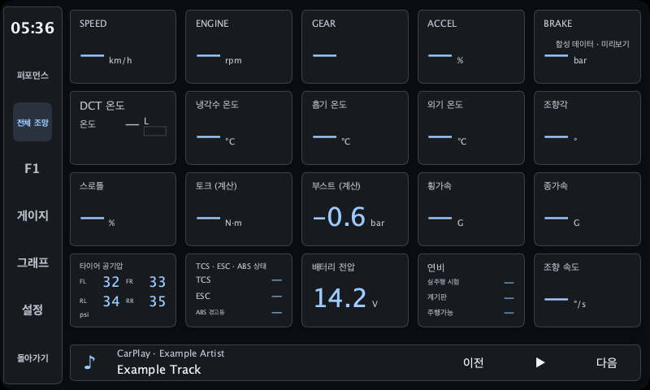
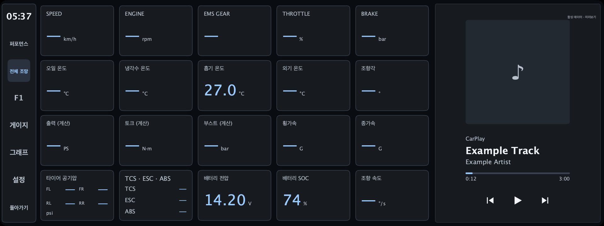
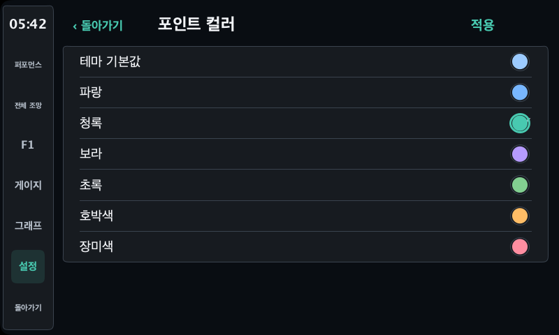
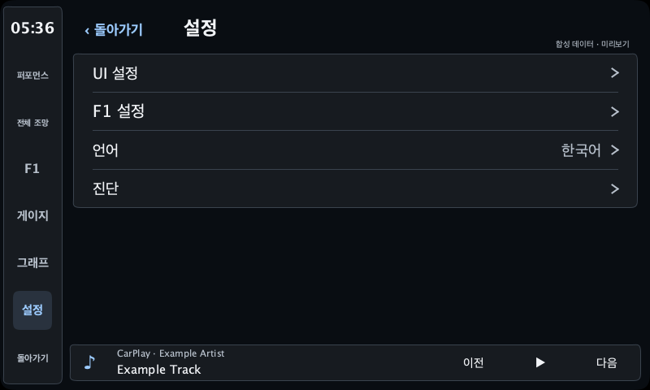

# Material Auto host previews

These captures use the bundled Material Auto theme and the Java2D renderer with synthetic vehicle/media data. They are source-level previews, not captures from an installed Android head unit.

## Overview · 800×480

## Overview with media · 1920×720

## Point color settings · 800×480

This uses the production `SettingsPageRenderer` for the palette rows and swatches; the selected example is teal.

## Settings root · 800×480

Waiting-state and wide settings captures are also in this directory.
