# Material Auto host previews

These images were regenerated from the current Dashboard Java renderers with the repository's Java2D `android.graphics` shim. Telemetry and media are synthetic examples. They are source previews, not Android-device or vehicle captures. Recreate the complete set with `python3 tools/render_theme_previews.py` from the repository root.

## Overview

- 800×480 Veloster JS, received values: 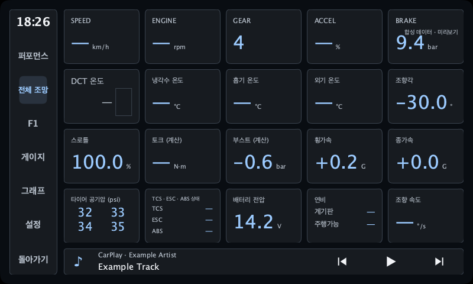
- 1920×720 CN7 display profile, received values and media: 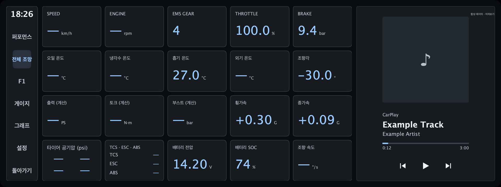
- 1920×720 CN7 display profile, waiting state: 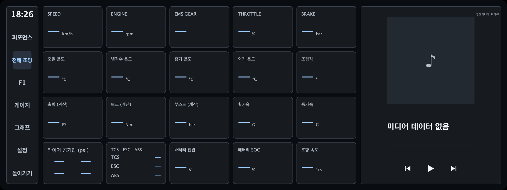

The CN7 selection controls preview resolution and layout only; its fixture reuses synthetic JS values and does not validate CN7 telemetry support.

## Settings

- 800×480 JS settings root: 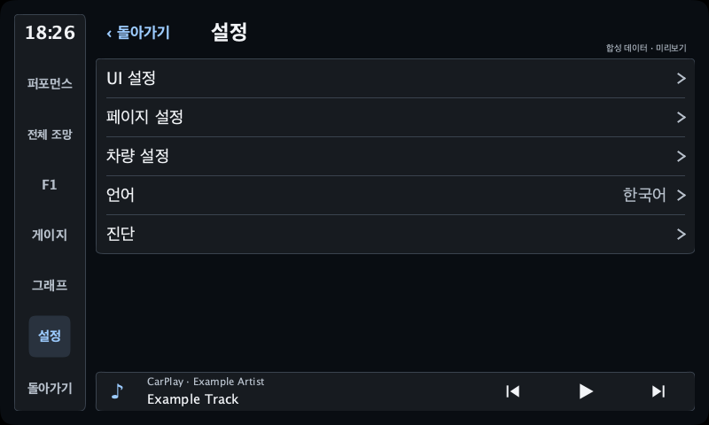
- 800×480 point-color swatches, with teal selected: 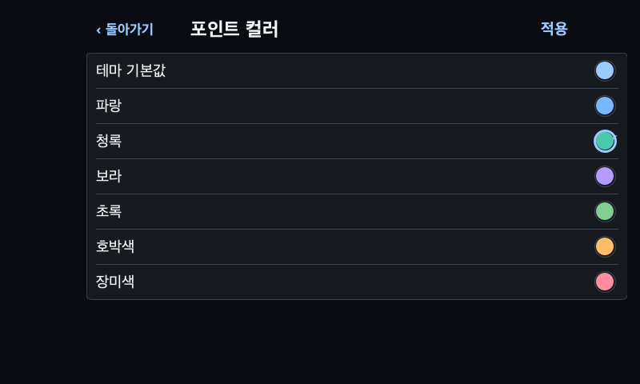
- 1920×720 CN7 settings with received and waiting fixtures: 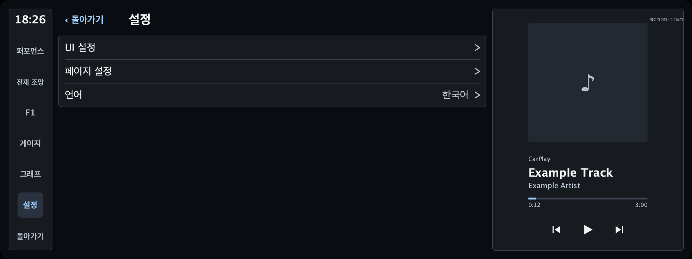 · 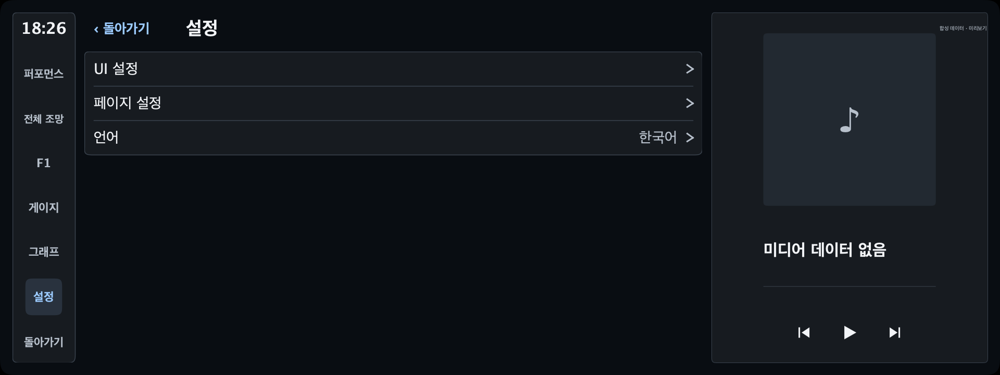
- 800×480 JS settings with waiting fixture: 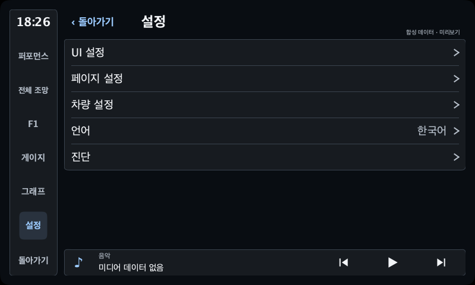

The point-color page uses the production `SettingsPageRenderer` swatch layout and `ThemePalette` colors. Its background is the Material Auto canvas; it is a page-level renderer capture, not a complete `DashboardView` screen.

## Other pages · 800×480 JS

- Performance: 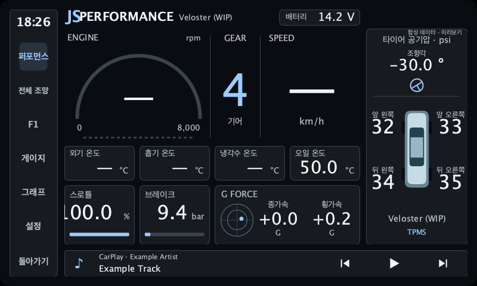
- F1: 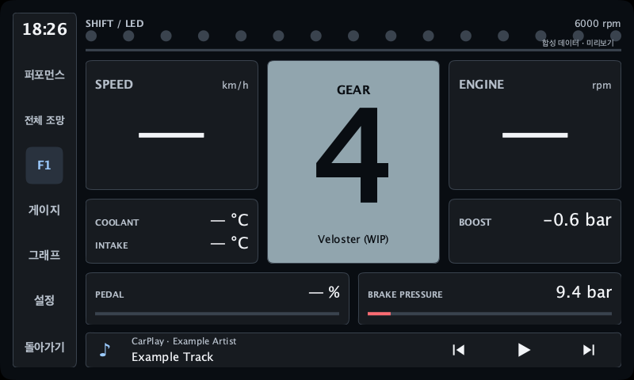
- Gauges: 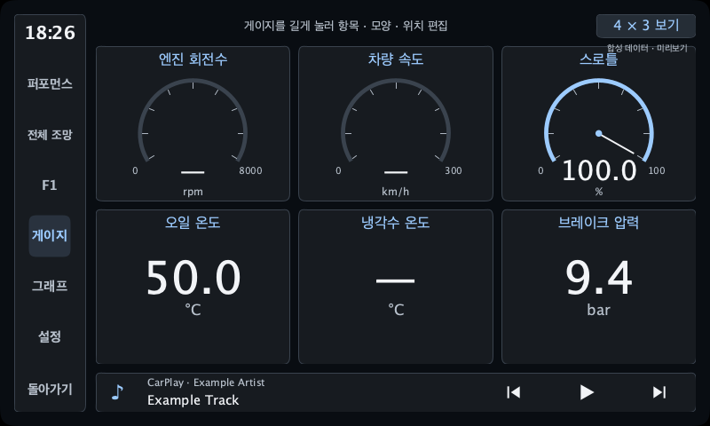
- Graphs: 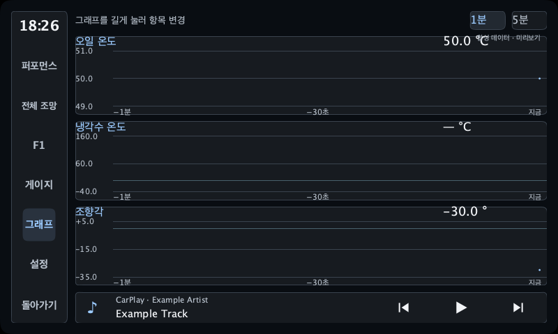
